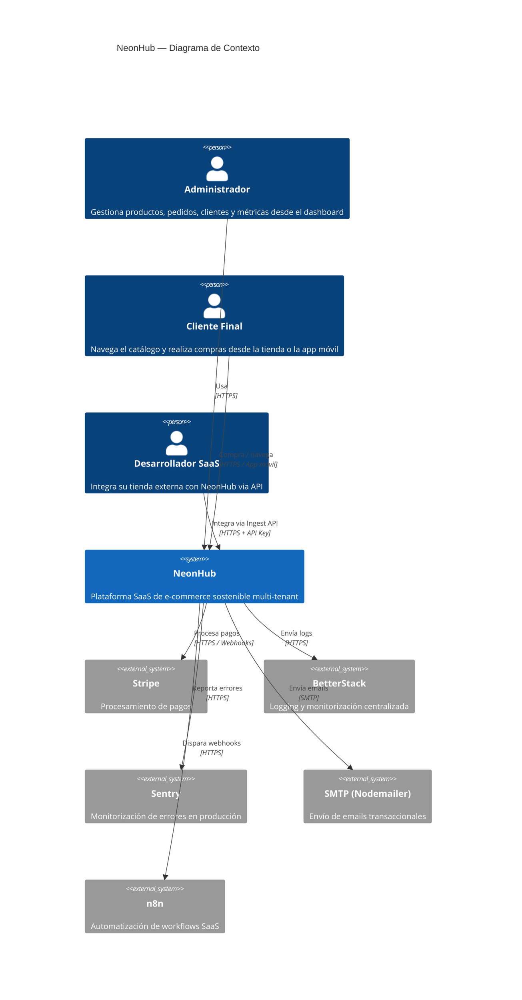
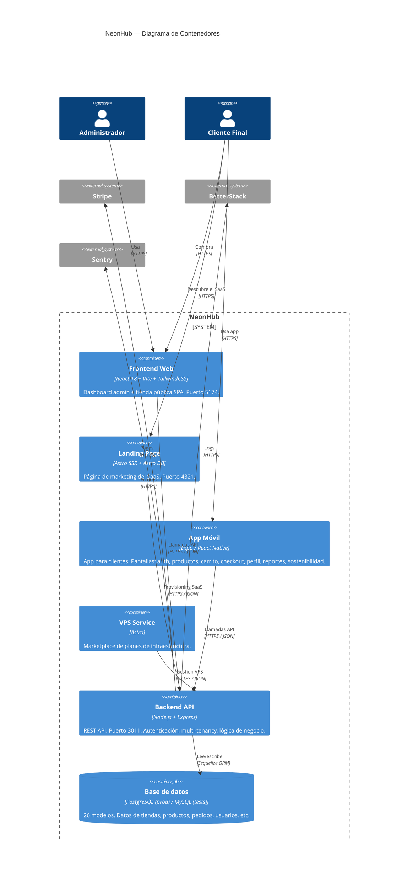
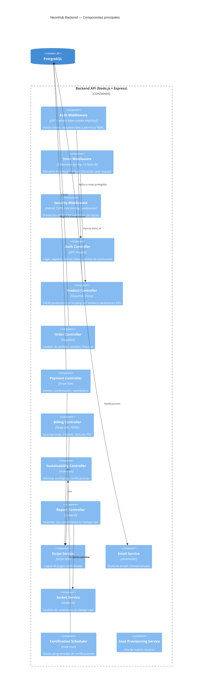
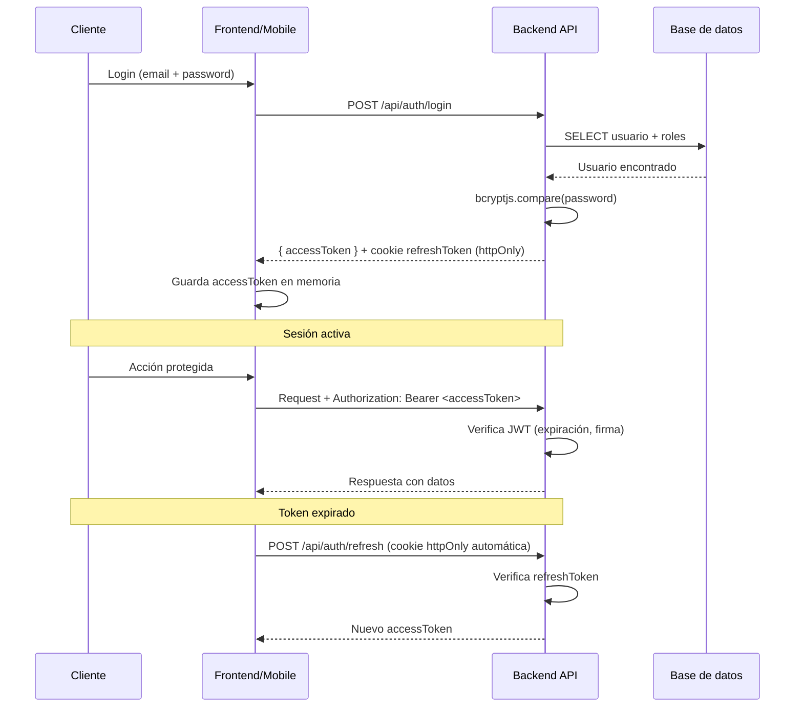
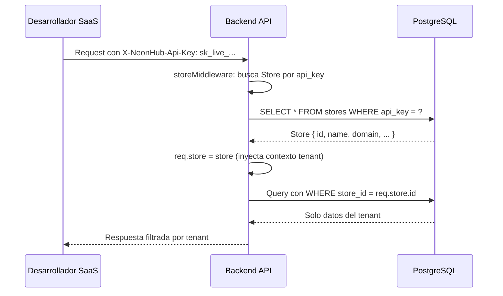
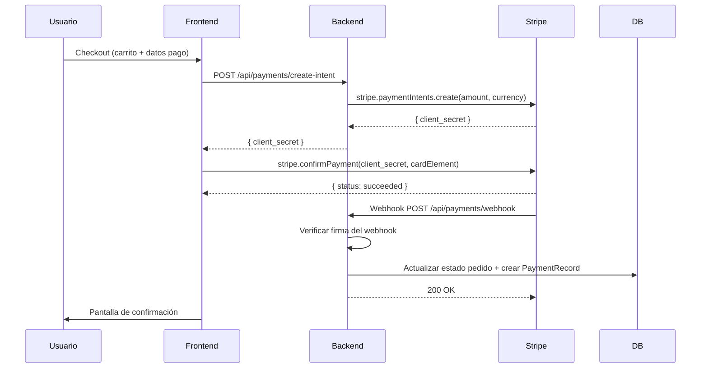
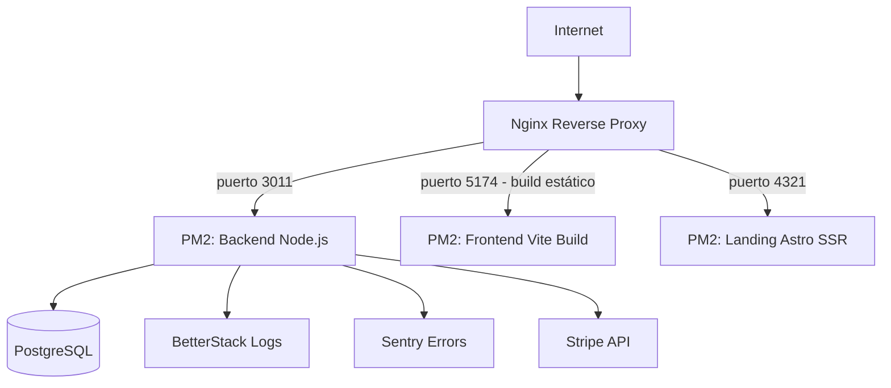

# NeonHub — Arquitectura del Sistema

**Versión**: 1.0
**Fecha**: 10 de abril de 2026

---

## 1. Visión general

NeonHub es una plataforma SaaS multi-tenant para gestión de e-commerce con enfoque en sostenibilidad. Está compuesta por cinco aplicaciones independientes que comparten la misma API backend.

---

## 2. Diagrama C4 — Nivel 1: Contexto

---

## 3. Diagrama C4 — Nivel 2: Contenedores

---

## 4. Diagrama C4 — Nivel 3: Componentes del Backend

---

## 5. Flujo de autenticación

---

## 6. Flujo de multi-tenancy

---

## 7. Flujo de pago

---

## 8. Despliegue en producción

**Archivos de configuración:**
- PM2: `ecosystem.neonhub.config.js`
- Nginx: `docs/nginx-nonhub.conf`

---

## 9. Estructura de módulos del backend

| Ruta | Controller | Descripción |
|------|-----------|-------------|
| `/api/auth` | authController | Login, registro, refresh, cambio de password |
| `/api/users` | userController | CRUD usuarios |
| `/api/products` | productController | CRUD productos (con tenant scoping) |
| `/api/categories` | categoryController | CRUD categorías (globales + por tenant) |
| `/api/orders` | orderController | Gestión de pedidos |
| `/api/public/*` | publicOrderController | Endpoints sin auth (catálogo, checkout guest) |
| `/api/cart` | cartController | Carrito de compras |
| `/api/customers` | customerController | Gestión de clientes |
| `/api/payments` | paymentController | Stripe intents, webhook, reembolsos |
| `/api/billing` | billingController | Suscripciones SaaS, invoices |
| `/api/sustainability` | sustainabilityController | Métricas ecológicas |
| `/api/certifications` | certificationController | Sistema de certificaciones |
| `/api/reports` | reportController | Reportes con comentarios |
| `/api/tickets` | ticketController | Tickets de soporte |
| `/api/notifications` | notificationController | Notificaciones internas |
| `/api/dashboard` | dashboardController | Métricas del dashboard |
| `/api/ingest/*` | ingestController | Ingest API para integraciones externas |
| `/api/admin` | tenantController | Gestión de stores/tenants |
| `/api/uploads` | uploadController | Subida de imágenes (Multer + Sharp) |
