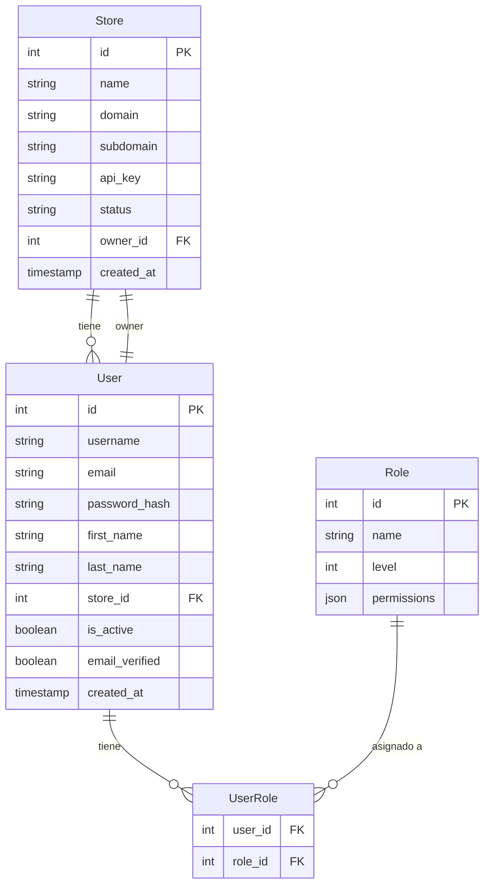
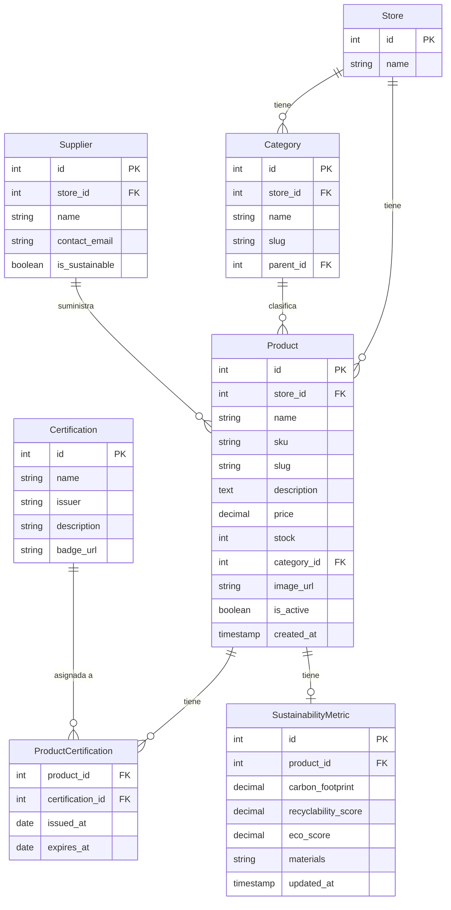
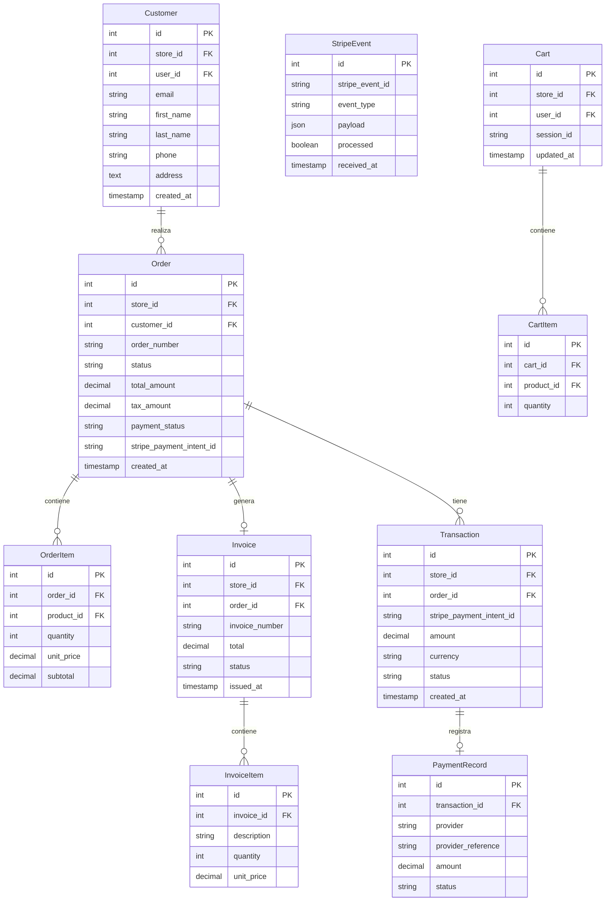
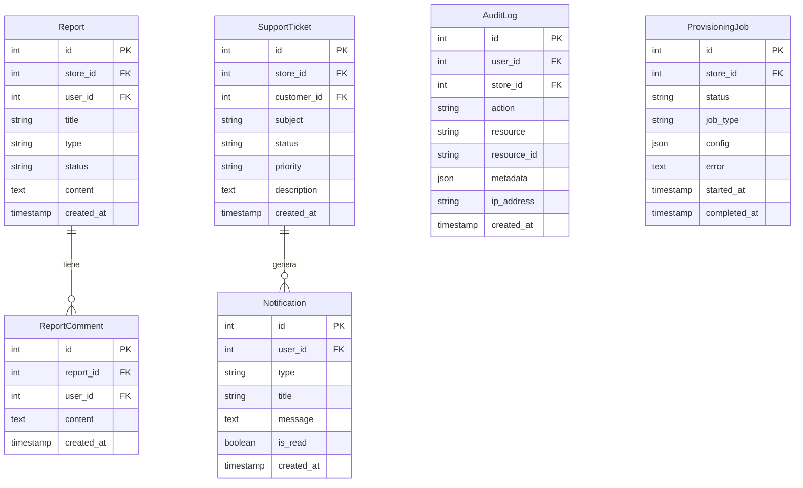

# NeonHub — Modelo de Datos

**Versión**: 1.0
**Fecha**: 10 de abril de 2026
**Base de datos**: PostgreSQL (producción) | MySQL (tests) | SQLite (fallback tests)
**ORM**: Sequelize

---

## 1. Resumen de modelos (26)

| Modelo | Descripción |
|--------|-------------|
| `User` | Usuarios del sistema (admins, empleados, clientes) |
| `Role` | Roles con permisos JSON |
| `UserRole` | Relación N:M entre usuarios y roles |
| `Store` | Tenant SaaS (tienda/empresa) |
| `Product` | Producto del catálogo |
| `Category` | Categorías de productos |
| `ProductCertification` | Relación N:M producto-certificación |
| `Certification` | Certificaciones ecológicas |
| `SustainabilityMetric` | Métricas ecológicas por producto |
| `Customer` | Cliente (puede coincidir con User) |
| `Order` | Pedido |
| `OrderItem` | Línea de un pedido |
| `Cart` | Carrito de compras |
| `CartItem` | Ítem en carrito |
| `Invoice` | Factura |
| `InvoiceItem` | Línea de factura |
| `Transaction` | Registro de transacción de pago |
| `PaymentRecord` | Detalle de pago (Stripe) |
| `StripeEvent` | Eventos de webhook de Stripe |
| `Report` | Reporte interno |
| `ReportComment` | Comentario en un reporte |
| `SupportTicket` | Ticket de soporte |
| `Notification` | Notificación interna |
| `Supplier` | Proveedor |
| `ProvisioningJob` | Job de aprovisionamiento de nuevo tenant |
| `AuditLog` | Log de auditoría de acciones |

---

## 2. Diagrama ER — Núcleo del sistema

---

## 3. Diagrama ER — Catálogo

---

## 4. Diagrama ER — Pedidos y pagos

---

## 5. Diagrama ER — Soporte y notificaciones

---

## 6. Constraints de multi-tenancy relevantes

Todos los modelos principales tienen `store_id` como clave foránea obligatoria. Además se han añadido índices de unicidad por tenant:

| Modelo | Unicidades por tenant |
|--------|----------------------|
| `Product` | `(store_id, sku)`, `(store_id, slug)` |
| `Order` | `(store_id, order_number)` |
| `Customer` | `(store_id, email)`, `(store_id, code)` |
| `Category` | `(store_id, slug)`, `(store_id, name)` |

Estos constraints garantizan que no pueden existir dos SKUs iguales dentro de la misma tienda, pero sí entre tiendas distintas.

---

## 7. Configuración de base de datos por entorno

| Entorno | Motor | Configuración |
|---------|-------|--------------|
| Producción | PostgreSQL | `DATABASE_URL` en `.env` |
| Tests | MySQL | Config en `backend/src/config/database.js` |
| Tests (fallback) | SQLite | Automático si MySQL no disponible |

Ver `backend/src/config/database.js` y `backend/.env.example` para detalles.
