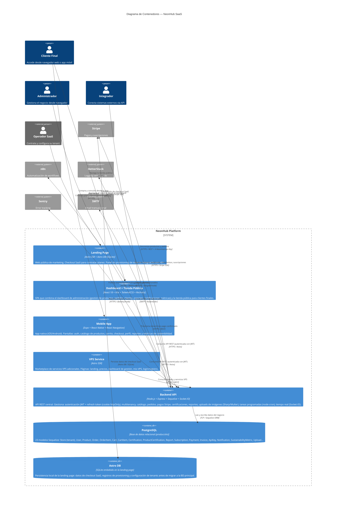

# C4 — Nivel 2: Diagrama de Contenedores

**Proyecto:** NeonHub  
**Nivel C4:** Container (Nivel 2)  
**Fecha:** 2026-04-10  

---

## Descripción

Este diagrama detalla los contenedores (procesos/aplicaciones desplegables) que componen NeonHub, las tecnologías de cada uno y cómo se comunican entre sí y con los sistemas externos.

---

---

## Contenedores

| Contenedor | Tecnología | Puerto (dev) | Descripción |
|------------|-----------|--------------|-------------|
| **Landing Page** | Astro SSR + Astro DB | 4321 | Marketing + checkout SaaS + provisioning |
| **Dashboard + Tienda** | React 18 + Vite | 5173 | SPA: admin dashboard y tienda pública |
| **Mobile App** | Expo + React Native | — | App nativa iOS/Android |
| **VPS Service** | Astro SSR | 4322 | Marketplace de servicios VPS |
| **Backend API** | Node.js + Express | 3000 | API REST + Socket.IO + cron jobs |
| **PostgreSQL** | Base de datos relacional | 5432 | Persistencia principal (23 modelos) |
| **Astro DB** | SQLite embebido | — | Datos locales de la landing page |

## Flujos principales

| Flujo | Ruta |
|-------|------|
| **Checkout SaaS (nuevo operador)** | Operador → Landing → Stripe → Backend (webhook) → PostgreSQL → n8n (onboarding) |
| **Compra en tienda** | Cliente → Frontend/Mobile → Backend → Stripe → PostgreSQL → SMTP (confirmación) |
| **Ingest API** | Integrador → Backend (API Key) → PostgreSQL |
| **Login / Sesión** | Usuario → Frontend/Mobile → Backend → JWT cookie httpOnly → PostgreSQL |
| **Observabilidad** | Backend → BetterStack (logs) + Sentry (errores) |
