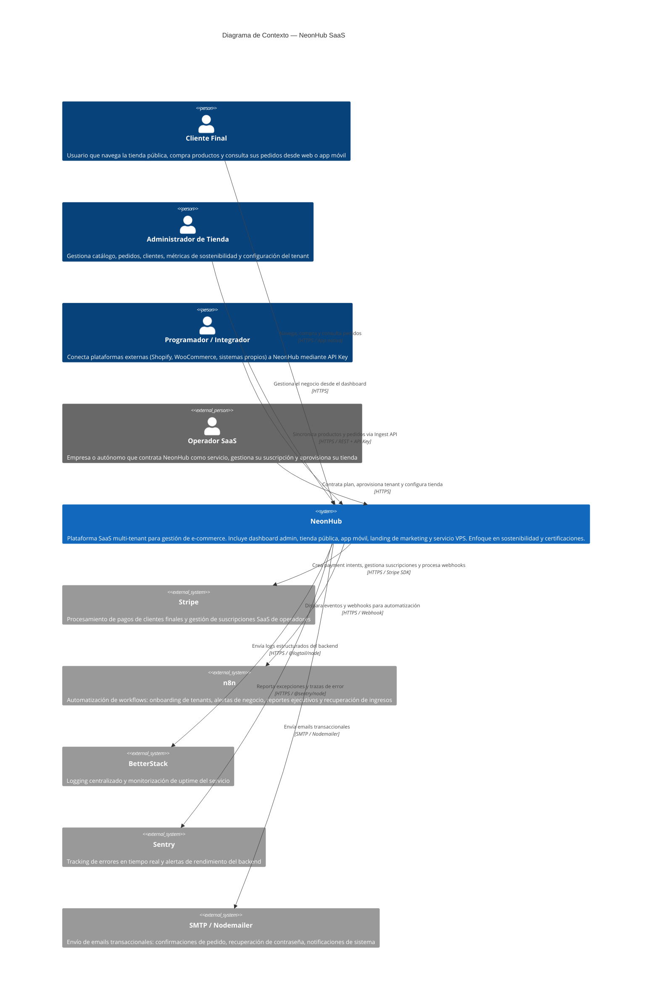

# C4 — Nivel 1: Diagrama de Contexto del Sistema

**Proyecto:** NeonHub  
**Nivel C4:** Context (Nivel 1)  
**Fecha:** 2026-04-10  

---

## Descripción

Este diagrama muestra NeonHub como sistema central, los actores que interactúan con él y los sistemas externos de los que depende. No detalla la arquitectura interna; eso se ve en el diagrama de Contenedores.

---

---

## Actores

| Actor | Tipo | Descripción |
|-------|------|-------------|
| **Cliente Final** | Usuario interno | Interactúa con la tienda pública (web) y/o la app móvil para comprar y consultar |
| **Administrador de Tienda** | Usuario interno | Usa el dashboard React para gestionar el negocio de su tenant |
| **Programador / Integrador** | Usuario interno | Consume la Ingest API con su API Key para sincronizar datos desde sistemas externos |
| **Operador SaaS** | Usuario externo | Empresa que contrata NeonHub; interactúa con la landing page para contratar y aprovisionar |

## Sistemas externos

| Sistema | Rol |
|---------|-----|
| **Stripe** | Pagos de clientes finales + suscripciones SaaS de operadores |
| **n8n** | Automatización: onboarding, alertas, reportes, revenue recovery |
| **BetterStack** | Observabilidad: logs del backend en producción |
| **Sentry** | Error tracking: excepciones del backend en tiempo real |
| **SMTP / Nodemailer** | Emails transaccionales (confirmaciones, notificaciones) |
